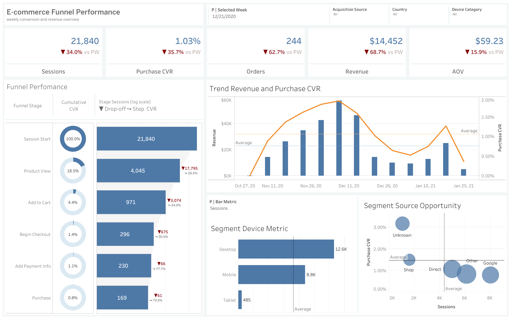

# E-commerce Funnel Analysis: where do we lose the most users?

> BigQuery SQL → weekly funnel table → Tableau Public dashboard.
> Data: GA4 obfuscated sample e-commerce dataset (Google Merchandise Store), 2020-11-02 to 2021-01-31.

**[→ Open the interactive dashboard on Tableau Public](https://public.tableau.com/app/profile/maksym.chobotar/viz/E-commerceFunnelPerfomance/E-commerceFunnelPerformance)**

## Business question
Where in the funnel do we lose the most users, and does that differ by device?

## Key findings
Out of 352,263 sessions, only 21.2% view a product at all - the single biggest drop in the
funnel (277,527 sessions) happens before the product page, not after it. Once a visitor views
a product, conversion through Add to Cart, Begin Checkout and Add Payment Info is nearly
identical across desktop, mobile and tablet (within ~1pp of each other at most steps). Tablet
shows a visibly different conversion at Add Payment Info and Purchase, but only 112 sessions
back that comparison, far fewer than desktop (3,061) or mobile (2,151) - too small a sample to
treat as a real pattern.

**Takeaway:** the opportunity here is not in device-specific funnel optimization - it's in why
~4 out of 5 sessions never reach a product page at all (traffic quality, landing page, site
speed). Device-level differences beyond Begin Checkout need more data before acting on them.

## Limitations
Descriptive, not causal: this shows *where* the drop-off is, not *why*. The tablet segment is
too small at the later funnel steps to draw conclusions from.
